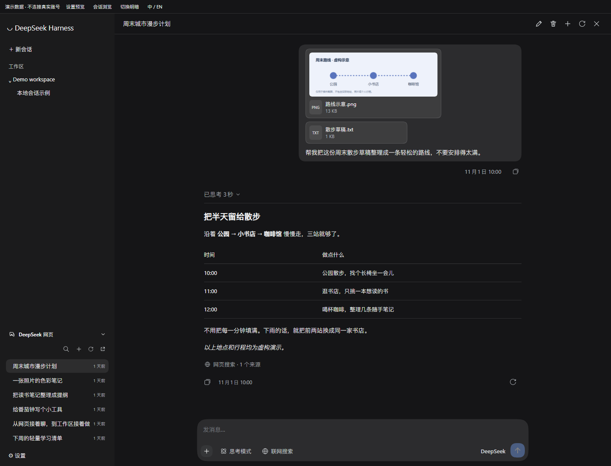
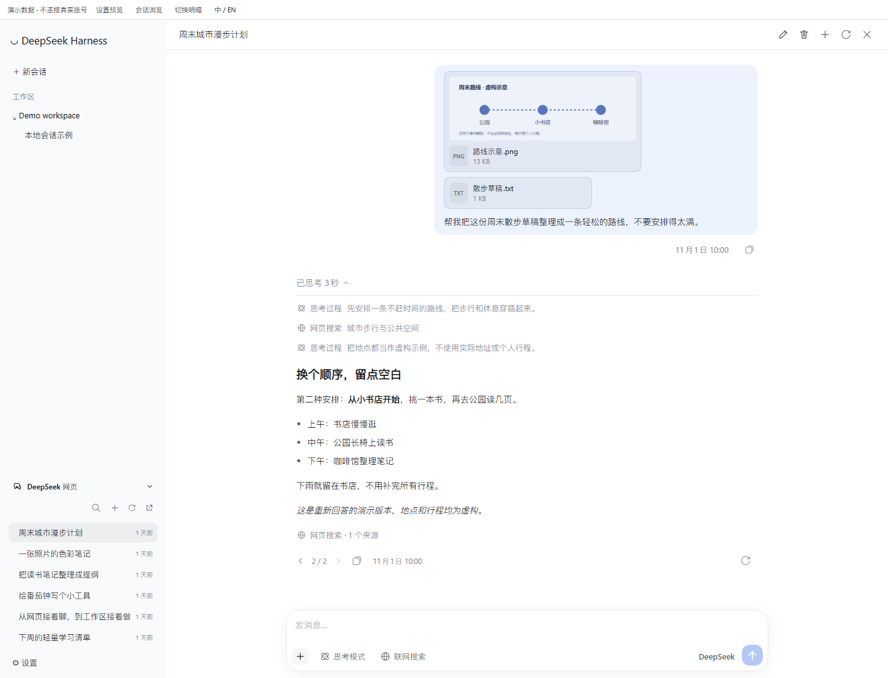
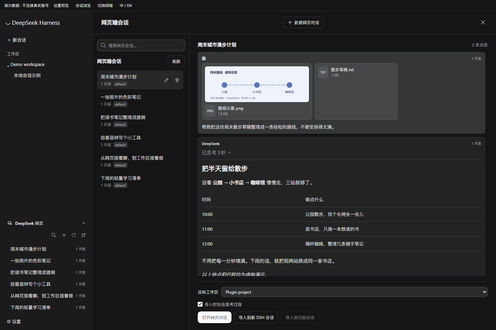
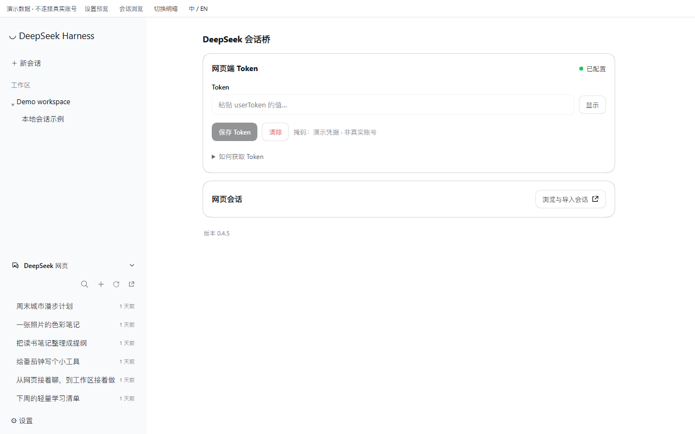

# DeepSeek Web Bridge · SaiSenBox

[中文](README.md) | English

Bring DeepSeek web conversations into DeepSeek Harness: keep chatting on the web account, or move a conversation and its attachments into a DSH workspace.

**Import in one step: drag a web conversation from the sidebar onto your target workspace and drop it.** The history and accessible images and files come along, so you can keep chatting in the workspace without copying and pasting everything.

I built it to stop copying context between two windows. Open a web conversation when you want to stay on the web account; drag it into a workspace when you want your local agent to take over.

This is an **unofficial plugin by SaiSenBox**, not a DeepSeek product and not the similarly named `dsh-deepseek-web` npm package. It uses private web endpoints that can change without notice.

## Features

- Inline sidebar conversations with search, create, rename and confirmed permanent deletion.
- Web chat with streaming, interleaved thinking/search steps, sources, images and file attachments.
- Regenerate an answer, switch between versions and continue from the selected branch.
- Drag a conversation into a workspace or preview it before importing. Readable attachments migrate to local DSH storage, with original files also saved in the workspace.
- Native DSH components and theme tokens, with Chinese/English following your app language.

Opening a web conversation writes replies back to the web account. Continuing an **imported** local conversation uses your DSH default model and does not write back to the original web thread.

## 25-second demo

[](https://github.com/SaiSenBox/dsh-web-bridge/blob/main/assets/promo/demo.mp4)

[Download the video (MP4, Chinese captions)](https://raw.githubusercontent.com/SaiSenBox/dsh-web-bridge/main/assets/promo/demo.mp4) · [Media credits and licenses](https://github.com/SaiSenBox/dsh-web-bridge/tree/main/assets/promo#credits)

## Screenshots

Keep chatting in DSH, with images and files in context.



Follow the thinking/search steps, then switch to another answer when you need one.



Preview first, then bring the conversation and attachments into a workspace.



Connection settings in one place, following the DSH theme.



## Install

Requires a compatible DSH 0.2.x release, starting at **0.2.1-rc.2** (`>=0.2.1-rc.2 <0.3.0`). Integration was checked against the official standalone desktop 0.2.1-rc.2, not every later release in the range. External Node installations need `^22.19.0 || >=24.0.0`; Desktop supplies its own runtime.

The npm package is `@xueray/dsh-web-bridge`. Install it into your actual profile:

```sh
dsh plugin --profile desktop add @xueray/dsh-web-bridge
# For the web profile instead:
dsh plugin --profile web add @xueray/dsh-web-bridge
```

Or install from GitHub. The package ships plain JavaScript and needs no build step:

```sh
dsh plugin --profile desktop add github:SaiSenBox/dsh-web-bridge
```

Local checkout or tarball:

```sh
dsh plugin --profile desktop add ./dsh-web-bridge
# Or a downloaded tarball:
dsh plugin --profile desktop add ./xueray-dsh-web-bridge-0.4.5.tgz
```

**Fully quit DSH, including the tray process, and reopen it after installing or updating.** A page refresh does not reload the Host routes.

Uninstall with `dsh plugin --profile desktop remove @xueray/dsh-web-bridge`, substituting your actual profile. Imported sessions and workspace files are not deleted.

The old local checkout can keep its directory name. The patch row ID, routes and browser preference keys remain stable, and the relative entry supports old local links. When migrating, remove the old bundle before adding the new one; **do not enable both copies**. Check that the legacy bundle is this project's old local install, not another author's similarly named package.

## Connect an account

1. Sign in at [chat.deepseek.com](https://chat.deepseek.com).
2. Open browser DevTools → Console and run:

   ```js
   JSON.parse(localStorage.getItem('userToken')).value
   ```

3. Paste the result into DSH Settings → **DeepSeek Web Bridge**. Never share it in chats, issues or screenshots.

DSH's credential service stores the `DEEPSEEK_WEB_TOKEN` reference. The same environment variable is also supported. Current DSH stores credentials in `$DSH_HOME/.credentials.yaml`: **plaintext protected by filesystem permissions**, not an encrypted vault.

The plugin's HTTP endpoints accept local, same-origin access by default. See [usage notes](docs/usage.md) for storage paths, tools and debugging variables.

## Limits and account safety

- This is not the official API. Check the service terms before using it. Even reads may be rate-limited; the plugin cannot guarantee account safety or continued access.
- Send, regenerate, create, rename and delete change your web account. Writes are not automatically replayed. After an interrupted stream, refresh to confirm what happened before sending again. Stopping local waiting does not necessarily stop the upstream generation.
- Your token is an account credential. Prompts and uploaded files are sent to DeepSeek. This plugin adds no separate telemetry or analytics service.
- Uploads: up to 10 files, 20 MiB each. Image previews: 12 MiB. Imports: image originals up to 20 MiB, other files up to 100 MiB, 500 MiB total. Expired, inaccessible and unsupported files are reported individually.
- Original files go into `deepseek-web-attachments/<session-id>-<random-suffix>/` inside the target workspace, without overwriting existing files. DSH separately manages its native attachment store.
- Injecting context into the current session is text-only and length-limited. Use a workspace/new-session import to migrate attachments.

## Development

```sh
npm run check
npm test
npm run verify:package
```

There are no third-party runtime npm dependencies. Offline tests do not need a token or send real messages. Package verification installs the actual tarball into a temporary directory and checks its entries, client module, notices and contents.

See the [release checklist](docs/releasing.md) and [integration notes](docs/usage.md). Remove credentials, signed file URLs and private conversation text from bug reports.

## License

Original work is copyright SaiSenBox, under [PolyForm Noncommercial 1.0.0](LICENSE). It permits uses, modifications and redistribution for the purposes defined in that license, with the license and `Required Notice` retained. It does **not** grant a general commercial-use license; the terms explicitly permit certain educational, charitable and other organizations. Contact the author for commercial licensing.

This is **source-available**, not OSI open source. Upstream MIT material retains its original terms: see [THIRD_PARTY_NOTICES.md](THIRD_PARTY_NOTICES.md). This change does not revoke rights already granted for previously distributed copies.
