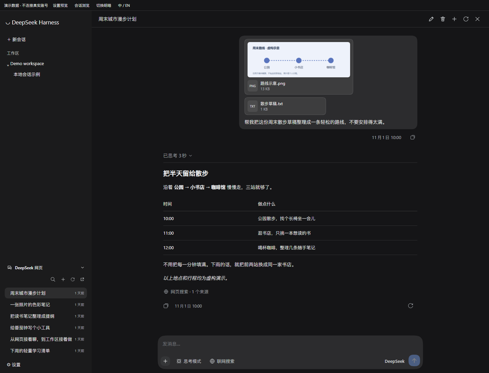
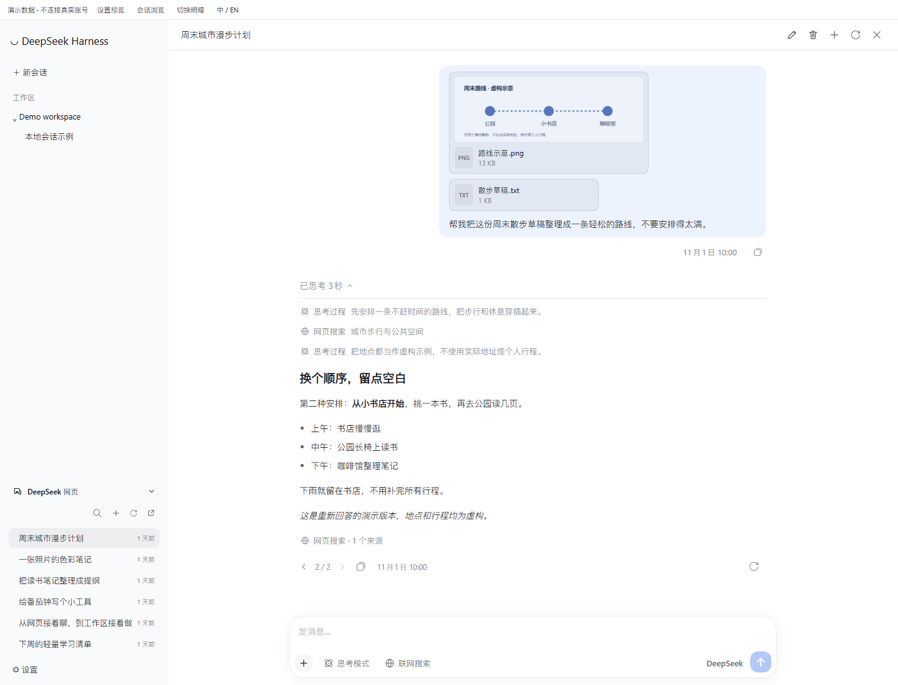
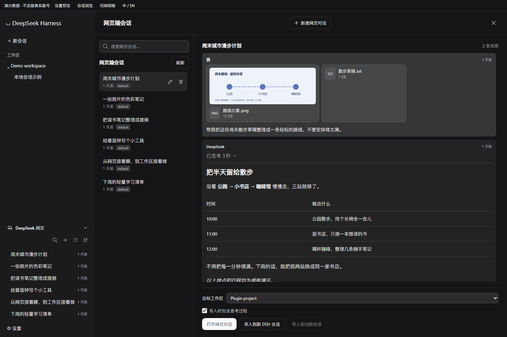
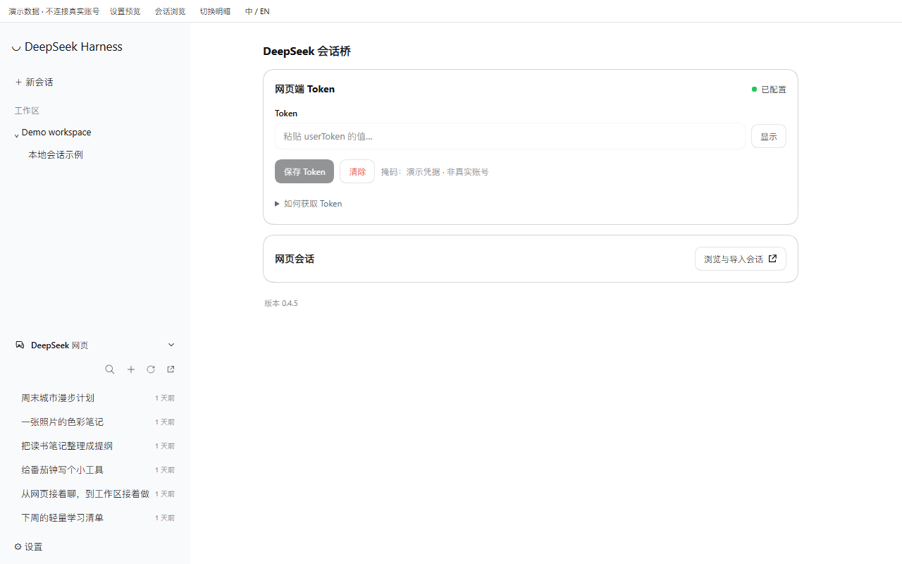

# DeepSeek 会话桥 · SaiSenBox

中文 | [English](README.en.md)

在 DeepSeek Harness 里接着聊网页端的对话，也能把历史和附件一起搬进工作区。

**导入就一步：把左侧网页会话拖到目标工作区，松手即可导入。** 历史消息和可读取的图片、文件会一起带过去，不用来回复制粘贴，导入后就能在工作区接着聊。

写它的原因挺简单：网页里聊了一半，切到 DSH 又得复制上下文；有图片、文件时就更麻烦了。所以做了一个桥——想留在网页账号里继续聊就直接打开，想交给工作区里的 Agent 接着做就拖进去。

这是 **SaiSenBox 的非官方插件**，不属于 DeepSeek 官方产品，也不是名称相近的 `dsh-deepseek-web` npm 包。网页接口没有稳定性承诺，可能随时变化；使用前请了解[风险与限制](#风险与限制)。

## 能做什么

- 工作区下方直接浏览网页会话，支持搜索、新建、重命名和删除。删除前会确认，不影响已经导入的本地副本。
- 在 DSH 内继续网页对话：流式回复、思考与搜索过程、来源、图片和附件，以及重新回答和回答版本切换。
- 把网页会话拖入工作区，变成真正的 DSH 会话；也可以预览后选择工作区导入。
- 导入时迁移可读取的图片和文件，同时把原文件放到目标工作区；失败项会单独列出，不会悄悄丢掉。
- 中文、英文随 DSH 设置切换，沿用原生主题、Markdown 和交互组件。

**两种“继续聊”不是一回事：**点击网页会话，回复会写回网页账号；拖入工作区后，继续对话使用 DSH 当前默认模型，不会写回原网页会话。

## 25 秒演示

[](https://github.com/SaiSenBox/dsh-web-bridge/blob/main/assets/promo/demo.mp4)

[下载视频（MP4）](https://raw.githubusercontent.com/SaiSenBox/dsh-web-bridge/main/assets/promo/demo.mp4) · [素材署名与许可](https://github.com/SaiSenBox/dsh-web-bridge/tree/main/assets/promo#素材署名)

## 看看界面

不用来回复制上下文，在 DSH 里直接接着聊。



思考和搜索按顺序展开；想换个答案，重答后切换版本就行。



先看一眼，再把历史和附件一起搬进工作区。



连接信息放在设置里，明暗主题跟着 DSH 走。



## 安装

需要 DSH **0.2.1-rc.2 或更新的兼容 0.2.x 版本**。本机集成验证基于官方独立桌面版 0.2.1-rc.2；声明的范围是 `>=0.2.1-rc.2 <0.3.0`，不代表已经逐个测试所有后续版本。外置 Node 需要 `^22.19.0 || >=24.0.0`，桌面版使用自带运行时。

npm 安装包为 `@xueray/dsh-web-bridge`；请按实际使用的 profile 安装：

```sh
# 独立桌面版
dsh plugin --profile desktop add @xueray/dsh-web-bridge

# Web profile，按实际使用的 profile 二选一
dsh plugin --profile web add @xueray/dsh-web-bridge
```

也可以安装 GitHub 源码（纯 JavaScript，无须额外构建）：

```sh
dsh plugin --profile desktop add github:SaiSenBox/dsh-web-bridge
```

本地开发或安装下载好的包：

```sh
dsh plugin --profile desktop add ./dsh-web-bridge
# 或：dsh plugin --profile desktop add ./xueray-dsh-web-bridge-0.4.5.tgz
```

装好或更新后，**完全退出 DSH，包括托盘进程，再重新打开**。只刷新页面不会更新 Host 接口。

卸载：`dsh plugin --profile desktop remove @xueray/dsh-web-bridge`。换成你的实际 profile；卸载不会删除已导入的会话或工作区文件。

旧本地开发目录无需改名。插件保留 `deepseek-web` 配置行 ID、接口和浏览器偏好键；相对入口也兼容旧的本地链接。迁移到新包时，应先移除旧 bundle，再安装新包，**不要同时启用两份**。卸载旧 bundle 时请核对它确实是你以前安装的本项目，而不是其他作者的同名包。

## 连接网页账号

1. 浏览器登录 [chat.deepseek.com](https://chat.deepseek.com)。
2. 打开开发者工具 Console，执行下面这行，复制结果：

   ```js
   JSON.parse(localStorage.getItem('userToken')).value
   ```

3. 在 DSH 设置 → **DeepSeek 会话桥** 粘贴并保存 Token。不要把输出发到聊天、Issue 或截图里。

Token 交给 DSH 的凭据服务保存，引用名是 `DEEPSEEK_WEB_TOKEN`；也可通过同名环境变量提供。当前 DSH 的凭据文件是 `$DSH_HOME/.credentials.yaml`，属于**受文件权限保护的明文存储**，不是加密保险箱。导出配置、备份或分享日志时请注意。

默认仅允许本机同源请求访问插件接口。调试用环境变量及附件位置见[使用说明](docs/usage.md)。

## 风险与限制

- 使用的是 **非公开网页接口**，不是官方 API。请先确认你的使用符合上游服务条款；读取也可能被限流，不能保证账号不会受限。
- 发送、重答、新建、改名、删除会修改网页账号。写请求不自动重放；断流或停止后请刷新确认结果，别急着重复发送。停止本机等待不等于撤回上游生成。
- Token 相当于登录凭据。插件会连接 DeepSeek；发送的文字和文件会交给该服务。本插件不添加独立的遥测或第三方分析服务。
- 上传最多 10 个附件，单个 20 MiB；图片预览上限 12 MiB。导入图片原文件上限 20 MiB，其他文件单个 100 MiB，一次总计 500 MiB。过期、无权限或不受支持的附件会报告失败。
- 原文件保存到目标工作区的 `deepseek-web-attachments/<会话ID>-<随机后缀>/`，不覆盖已有文件。DSH 原生附件另由其附件服务管理；详见[附件说明](docs/usage.md#附件保存在哪里)。
- “注入当前会话”是有长度限制的文本上下文，不会迁移附件。要保留附件请选择工作区/新会话导入。

## 开发与发布

```sh
npm run check
npm test
npm run verify:package
```

运行时没有第三方 npm 依赖。测试使用离线 fixtures，不要求账号，不会向真实网页会话发送消息。打包检查会在临时目录安装实际 tarball，检查入口、前端模块、许可和文件清单。

准备发布或提交收录前，按[发布清单](docs/releasing.md)检查；[协议与集成说明](docs/usage.md)记录了工具、存储和接口边界。欢迎报错，但请先去掉 Token、签名图片地址和私人聊天内容。

## 许可

原创代码采用 [PolyForm Noncommercial 1.0.0](LICENSE)，版权归 SaiSenBox。简单说：允许条款范围内的非商业使用、修改和分享，分发时须保留许可与 `Required Notice` 署名；**没有授予商业用途的一般许可**。该协议对教育、公益等机构另有明确许可情形，请以全文为准。商业授权请联系作者。

这是非商业**源码可用**项目，不宣称符合 OSI 开源定义。上游 MIT 内容仍保留原许可，见 [THIRD_PARTY_NOTICES.md](THIRD_PARTY_NOTICES.md)；协议变更不追溯撤销此前已授出的许可。
